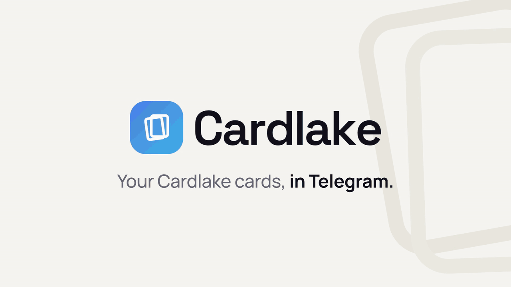
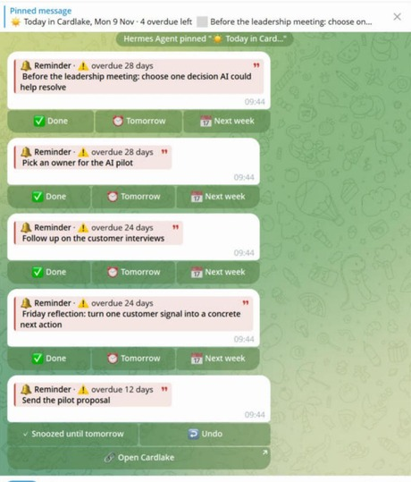

# Cardlake for Hermes Agent

[](https://github.com/cardleforall/cardlake-hermes/actions/workflows/tests.yml)

Your [Cardlake](https://cardlake.app) cards in [Hermes](https://hermes-agent.nousresearch.com), laid out as cards in Telegram, with what's due sent to you each morning.



You need a free Cardlake account, and nothing to host: the plugin runs inside Hermes and connects to cardlake.app. It works with a self-hosted copy of Cardlake too: see [Self-hosted Cardlake](#self-hosted-cardlake).

## Requirements

- [Hermes Agent](https://hermes-agent.nousresearch.com) 0.22.5 or newer.
- A free [Cardlake](https://cardlake.app) account, or your own copy of Cardlake.
- Telegram for the cards with buttons. On other chat platforms the same cards arrive as one message without buttons.

## Install

From the [Hermes plugin catalog](https://hermes-agent.nousresearch.com/docs/user-guide/features/plugin-catalog):

```bash
hermes plugins install cardlake --enable
```

Or straight from GitHub:

```bash
hermes plugins install cardleforall/cardlake-hermes --enable
```

## Sign in

Connect Hermes to Cardlake. Your browser opens so you can sign in:

```bash
hermes mcp add cardlake --url https://cardlake.app/api/mcp --auth oauth
```

Keep the name `cardlake`, and don't add a client name, client id or fixed port: those turn off the sign-in Cardlake accepts. To sign in again later, run `hermes mcp login cardlake`.

This is a separate step because a Hermes plugin with commands can't carry a sign-in connection of its own.

## Self-hosted Cardlake

Connect to your own copy's address instead of cardlake.app, keeping the name `cardlake`:

```bash
hermes mcp add cardlake --url https://cardlake.example.com/api/mcp --auth oauth
```

There's nothing else to set. The plugin reads that address from Hermes, so every Open Cardlake link and button opens your copy. Restart Hermes after changing it. If your copy's web pages are on a different address from its API, set `CARDLAKE_URL` to the web address (for example `https://cardlake.example.com`) in Hermes' `.env`.

Your copy needs Cardlake's sign-in and tools: the plugin uses the same ones as cardlake.app. The open-source Cardlake, with a one-click deploy, is [cardleforall/cardlakeforall](https://github.com/cardleforall/cardlakeforall).

## Commands

| Command | What it does |
| --- | --- |
| `/cardlake feed` | Shows the top of your feed as cards |
| `/cardlake feed <filter>` | Shows just one kind: `reminders`, `learning`, `work`, `family`, `bookmarks`, `misc`, `github`, `files`, `favorites` (cards you've hearted) or `snoozed` (with a Bring back button, and when each card comes back) |
| `/cardlake today` | Shows reminders that are overdue or due today |
| `/cardlake deal` | Deals you five cards to look at again, like the app's Deal me 5: none that are overdue, due today or pinned |
| `/cardlake save <text>` | Saves your text as a card; your model picks the kind |
| `/cardlake snooze <text>` | Snoozes the matching card until tomorrow. If several match, it asks which first |

Days follow your time zone: the `timezone` set in Hermes, otherwise your computer's.

## How cards look

Each card is a quote block, which Telegram shows as a panel: its type, whether it's overdue or due today, a 📌 if it's pinned, the title in bold, and a short link when it has one. The 3 most urgent cards are shown in full (overdue, then due today, then pinned) and the rest get one line each, up to 8.

No boxes or ASCII art, which only line up in a terminal.

### In Telegram



In your private Telegram chat with Hermes, `/cardlake feed`, `today` and `deal` send each card shown in full as its own message, with its buttons right under it: ✅ Done (reminders and learnings), ⏰ Tomorrow and 📅 Next week. The rest of the list follows, with a 🔗 Open Cardlake button.

- **A tap changes only the card above it.** Its buttons then say what happened, with **↩ Undo** next to them. Undo puts the card back as it was, including its pin and, for a reminder, its date.
- **Today comes with a pinned checklist.** `/cardlake today` and the morning message start with a list of what's due, pinned to the top of the chat. Each tap ticks a line off, until it says nothing is left for today. The next one replaces the pin.
- **Learning cards show their video.** A learning card's message previews its link, so a talk or course shows its thumbnail. Other messages show no preview.

Group chats, forum topics, other platforms and Hermes versions without plugin button support get the whole reply as one message instead. Telegram previews the first link in a message, so that message's heading links to Cardlake: the preview under it is Cardlake's, not a video or article from one of your cards. To turn previews off altogether, add this to `~/.hermes/config.yaml` and restart the gateway. It applies to every Telegram message Hermes sends:

```yaml
gateway:
  platforms:
    telegram:
      extra:
        disable_link_previews: true
```

The plugin also tells Hermes to show cards the same way in ordinary replies, such as "what's on my plate?". Models follow this most of the time, not always.

## Hermes' own results as cards

Hermes can show its own results as cards too: links and videos it found, research findings, options, tasks, or a scheduled job's report. It does this with the `cardlake_show_cards` tool, which the plugin adds and tells Hermes about. In your private Telegram chat each item arrives as a card with **💾 Save to Cardlake** and **⏰ Remind me** (a reminder for tomorrow), both with Undo. Nothing is saved unless you tap. Elsewhere, Hermes gets the same cards back as text for its reply.

Whether Hermes uses the tool is up to your model. To be sure, ask for it: "show these as cards".

## In chat

- **Reply to update.** Say "done", "tomorrow" or "next week" with a card's name, or in reply to a card, and Hermes updates it. If more than one card matches, it asks which.
- **Forward to save.** Forward a link or a message, or send a voice note, with nothing else, and Hermes saves it as one card: articles, videos and courses as learnings, other links as bookmarks, anything with a date as a reminder, the rest as Misc.
- **Link to your feed.** Every `/cardlake` reply, and any reply in which Hermes used Cardlake, ends with `Open Cardlake: https://cardlake.app/vault/` (or your own copy's address). Other replies are left alone.

## Morning message

Run `/blueprint`, pick **Cardlake morning**, and choose a time. Each morning it sends your overdue and due-today reminders to your Telegram home channel: in a private chat, as the pinned checklist and cards with buttons described above; elsewhere, as one message laid out as cards. A morning with nothing due sends nothing. It runs once a day, so a reminder due later that afternoon shows up in the next morning's message, not at the time it's due.

The message is laid out by the plugin, not written by the model, so it looks the same every day. It never changes cards; the plugin blocks it from doing so. Keep the job's name as it is, because that's how the plugin recognizes it.

## Privacy and safety

- Passwords, API keys and tokens are removed in code before anything is sent to Cardlake. The removal works by pattern, so it can't promise to catch every secret, and it sometimes removes harmless text that looks like one.
- `/cardlake save` sends your text to the model you already use in Hermes, with those secrets removed. The text is treated as content, never as instructions, and the plugin checks the model's answer: it can only create one card.
- The plugin never reads your past Hermes conversations.

What the plugin does, so you know before installing:

- **Network:** it talks to Cardlake only through the `cardlake` connection you signed in to (cardlake.app or your own copy), and to Telegram only through the bot Hermes already runs: to send and pin card messages in your private chat, and to add `/cardlake` to the bot's `/` menu (unless you've set that menu up yourself). Nothing else.
- **Your model:** `/cardlake save` asks the model Hermes already uses to pick the card's kind.
- **Stored data:** it keeps the id of the Today message it pinned, in Hermes' plugin storage, so the next one can replace it. Button state lives in memory and is gone after a restart.
- **No** shell commands, files read outside its own folder, stored credentials, background processes or telemetry. The only scheduled job is the morning message, and only if you create it.

## Troubleshooting

| You see | What to do |
| --- | --- |
| "Cardlake isn't connected" | Run `hermes mcp login cardlake`, sign in, then start a new session. |
| `/cardlake` isn't in Telegram's `/` menu | The plugin adds it within a couple of minutes of Hermes connecting to Telegram; reopen the chat to refresh the menu. If you've set up Hermes' Telegram menu yourself (`platforms.telegram.extra.command_menu`), the plugin leaves it alone: add `cardlake` to its `priority` list. Typing `/cardlake` always works. |
| "These buttons are out of date" | Hermes was restarted since those cards were sent, or they're more than 300 messages old. Run the command again for fresh buttons. |
| Cards arrive as one long message, without buttons | Buttons only work in your private chat with Hermes on Telegram. Check `hermes logs` for a line starting `Cardlake:`. |
| A tap takes a while | Hermes is busy with a long task; the tap goes through when it's free. |
| "Still working on the last tap…" | You tapped twice. The first tap is still being saved, and the second is ignored so nothing happens twice. |
| Nothing arrives in the morning | Check the job with `hermes cron list`. It sends nothing on days when nothing is overdue or due. |

## Updating

```bash
hermes plugins update cardlake
```

Then send `/restart` to Hermes, or run `hermes gateway restart`: until then Hermes keeps running the old version. If the update says cardlake is not in the Hermes plugin catalog, install it again over the old copy (your sign-in and settings stay):

```bash
hermes plugins install cardleforall/cardlake-hermes --force --enable
```

## Tests

```bash
python -m unittest discover -t . -s tests
```

With Hermes installed, it also tests against the real thing; without it, those tests are skipped. On GitHub, every push runs the tests on Python 3.11 to 3.13, against the latest Hermes (with nothing skipped), and through Hermes' own plugin validator, and once a week in case a Hermes change breaks something.

What changed in each version is in the [changelog](CHANGELOG.md). Issues are welcome; see [CONTRIBUTING.md](CONTRIBUTING.md).

## License

[GNU AGPL-3.0](LICENSE).
